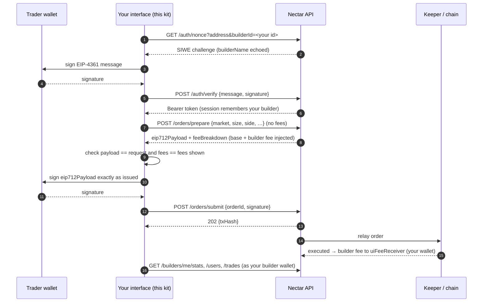

# Nectar Builder Kit

A forkable reference interface for **builders** on Nectar: teams that run their own trading front end on top of
Nectar's perpetuals and earn a **builder fee** on every order their users place.

The kit is a small, complete app with three parts:

- **Trade.** The interface you ship to traders: markets, a candlestick chart, order book, recent trades, an order form
  that shows the fee breakdown before signing, and order history.
- **Builder dashboard.** Your profile, fees earned over time, users, attributed trades and fee-rate settings.
- **API Explorer and API Inspector.** Every endpoint the kit uses, where the UI uses it, and the exact request and
  response of every call the interface makes.

The Builder Fee API is not live yet, so by default the kit runs against an **in-browser mock backend** that speaks the
same wire format as the spec, verifies real wallet signatures, and is seeded with sample data. Switching to the real
API is one environment variable.

This is a case study built from `nectar-frontend`. It reuses that app's API contract, market config, palette and
conventions, but it is self-contained: it has its own `package.json` and lockfile, and nothing in it is imported by
the main app.

---

## Contents

1. [Quick start](#1-quick-start)
2. [A five-minute tour](#2-a-five-minute-tour)
3. [How builder fees work](#3-how-builder-fees-work)
4. [Where each API request is used](#4-where-each-api-request-is-used)
5. [Architecture](#5-architecture)
6. [The mock backend](#6-the-mock-backend)
7. [Going live](#7-going-live)
8. [Forking it for your product](#8-forking-it-for-your-product)
9. [Case study: how the kit maps to nectar-frontend](#9-case-study-how-the-kit-maps-to-nectar-frontend)
10. [Spec notes and open questions](#10-spec-notes-and-open-questions)
11. [Testing](#11-testing)
12. [Reference](#12-reference)

---

## 1. Quick start

Requirements: Node 18+ and Yarn 4 (`corepack enable` gives you the version pinned in `package.json`).

```bash
cd builders_demo
yarn install
yarn start          # http://localhost:3020
```

Other scripts:

```bash
yarn test:ci        # unit + mock-backend integration tests (Vitest)
yarn tscheck        # strict TypeScript check
yarn build          # typecheck + production build to dist/
yarn preview        # serve dist/
```

The kit is its own Yarn project (its own `yarn.lock` and `.yarnrc.yml`), so installing here never touches the root
app's dependencies. The root app's Vitest config excludes this folder.

---

## 2. A five-minute tour

The Overview page has the same checklist with links.

1. Open **Trade**. The header wallet is the **Demo trader**. Press **Sign in** and open the **API Inspector** at the
   bottom: you will see `GET /auth/nonce` then `POST /auth/verify`, with full request and response bodies.
2. Enter a size and press **Review long**. `POST /orders/prepare` returns the order with fees injected. The form
   shows base fee + builder fee and confirms that the payload matches what you asked for.
3. Press **Sign & submit**. The demo wallet signs the EIP-712 payload and `POST /orders/submit` answers `202`. Your
   order appears as *Open* in **Your orders** and turns *Executed* about 4 seconds later.
4. In the header, switch to **Demo builder (PerpDesk)**, open **Builder dashboard** and sign in. The trade you just
   placed is the newest row in **Attributed trades**, with its builder fee.
5. Change the fee rate in **Settings**, go back to Trade as the trader, and prepare another order: the new rate
   applies. Or use **Demo: attribute the next sign-in to** and pick *Lumen Bot (frozen)* to watch the nonce get
   rejected with `BUILDER_FROZEN` and sign-in fall back to no attribution.

Every panel has small endpoint badges (e.g. `GET /builders/me/stats 200 · 180ms`). Click one to open the inspector
filtered to that endpoint.

---

## 3. How builder fees work



Rules the kit relies on:

| Rule | Where it is enforced |
| --- | --- |
| Attribution is fixed when the nonce is issued. Changing it means signing in again. | `src/context/WalletContext.tsx` (`setAttribution` signs out) |
| An unknown (`UNKNOWN_BUILDER`) or frozen (`BUILDER_FROZEN`) builder never locks a trader out: sign-in retries without `builderId`. | `WalletContext.signIn`, same as `nectar-frontend/src/lib/auth/siweLogin.ts` |
| The client never sends fee amounts. The backend injects them from the session's builder. | `src/pages/Trade/OrderForm.tsx`, `src/mock/routes/orders.ts` |
| The interface checks the prepared payload before asking for a signature. | `src/lib/orderChecks.ts` |
| The wallet signs the payload exactly as issued. Any edit, fees included, fails with `SIGNATURE_MISMATCH`. | `src/lib/eip712.ts`, `src/mock/routes/orders.ts` |
| `0 ≤ feeRateBps ≤ feeCapBps ≤ 10` (spec §13 recommendation). A builder may change only `feeRateBps`, `contactEmail` and `description`. | `src/pages/Dashboard/SettingsCard.tsx`, `src/mock/routes/builder.ts` |
| `/builders/me/*` identify the builder from the session wallet, never from a parameter. | `src/mock/routes/builder.ts` (`requireBuilder`) |

**Fee arithmetic.** `builder fee = sizeDeltaUsd × feeRateBps / 10 000`. On a $10,000 order at 5 bps the builder
earns $5.00. On-chain amounts are USD × 10^30 integers (the GMX convention); the kit does that math with `bigint`
(`src/lib/units.ts`) and converts to `number` only for display.

---

## 4. Where each API request is used

All endpoints are declared once in `src/api/catalog.ts`. The UI tags every request with the panel that made it, which
is what the API Inspector shows in its *From* column.

| Endpoint | Auth | Used by (UI panel) | Hook / caller |
| --- | --- | --- | --- |
| `GET /auth/nonce` | public | Header › Wallet & sign-in | `WalletContext.signIn` |
| `POST /auth/verify` | public | Header › Wallet & sign-in | `WalletContext.signIn` |
| `GET /auth` | session | Trade › Order form (builder fee preview), attribution card | `useAuthSession` |
| `GET /oracle-keeper/prices/tickers` | public | Trade › Market header, Order form (mark price) | `useTickers` |
| `GET /oracle-keeper/prices/24h` | public | Trade › Market header | `useDayStats` |
| `GET /oracle-keeper/prices/candles` | public | Trade › Price chart | `useCandles` |
| `GET /orderbooks/:symbol` | public | Trade › Order book | `useOrderbook` |
| `GET /trades/:symbol` | public | Trade › Recent trades | `useRecentTrades` |
| `GET /accounts/:account/orders` | public | Trade › Orders | `useAccountOrders` |
| `POST /orders/prepare` | session | Trade › Order form (Review) | `usePrepareOrder` |
| `POST /orders/submit` | session | Trade › Order form (Sign & submit) | `useSubmitOrder` |
| `GET /builders/me` | builder | Builder › Profile, sign-in gate | `useBuilderMe` |
| `GET /builders/me/stats` | builder | Builder › Stats | `useBuilderStats` |
| `GET /builders/me/users` | builder | Builder › Users | `useBuilderUsers` |
| `GET /builders/me/trades` | builder | Builder › Fees chart (all pages in the period), Trades | `useBuilderTradesSince`, `useBuilderTrades` |
| `PATCH /builders/:builderId` | builder | Builder › Settings | `useUpdateBuilder` |

Hooks live in `src/hooks/queries.ts`. Response shapes are in `src/api/types.ts`; the API Explorer shows the type
name next to every response.

**Not used by the kit:** the admin endpoints (`/admin/*`, `POST /builders`, `GET /builders`,
`PATCH /admin/builders/:id/status`) and the indexer endpoints. Those are operated by Nectar, not by builders.
Registration is an admin action: ask Nectar for a builder ID.

---

## 5. Architecture

### Layers

```
 pages/ + components/        presentation: one panel = one or two endpoints, badges show which
        │
 hooks/queries.ts            React Query: caching, polling, keys scoped to the session token
        │
 api/endpoints.ts            api.builder.stats(params, source) …  ← copy this file into your app
        │
 api/client.ts               resolve endpoint from catalog → attach Bearer → record in Inspector → ApiError on 4xx/5xx
        │
 api/transport.ts            Transport = (request) => Promise<{status, body}>
   ├── httpTransport         fetch(VITE_NECTAR_API_URL + path)          (live)
   └── mock/server.ts        in-browser router with the same contract  (mock)
```

The UI, hooks and client run **the same code** in mock and live mode. `src/main.tsx` is the only place that picks
the transport.

### Folder map

```
builders_demo/
├── index.html, vite.config.ts, tailwind.config.js, tsconfig.json
├── .env.example                  VITE_API_MODE, VITE_NECTAR_API_URL, VITE_BUILDER_ID
└── src/
    ├── main.tsx                  installs the transport, renders <App/>
    ├── App.tsx                   providers, HashRouter (React Router v5), ?builderId= link capture
    ├── config.ts                 everything a fork changes: mode, base URL, builder ID, chain, limits
    ├── api/
    │   ├── types.ts              wire types for every endpoint (from the Builder Fee spec)
    │   ├── catalog.ts            endpoint registry: method, path, auth, params, examples, UI usage
    │   ├── client.ts             callEndpoint(): the single request path
    │   ├── endpoints.ts          typed api.* functions
    │   ├── transport.ts          Transport interface + fetch implementation
    │   └── errors.ts             ApiError {status, code, message}
    ├── context/
    │   ├── WalletContext.tsx     wallet, SIWE sign-in, session, attribution
    │   └── attribution.ts        builder ID precedence and the attribution link
    ├── hooks/                    React Query hooks, useNow
    ├── inspector/                API Inspector store (every call) and drawer UI
    ├── lib/
    │   ├── units.ts              1e30 USD math with bigint
    │   ├── eip712.ts             spec payload → signable typed data
    │   ├── orderChecks.ts        pre-sign verification of a prepared order
    │   ├── siwe.ts               EIP-4361 message from a nonce challenge
    │   ├── wallet.ts             demo signer (local key) and browser-wallet signer (EIP-1193)
    │   ├── feeSeries.ts          bucket trades into a fees-over-time series
    │   ├── markets.ts            markets + token addresses (AssetChain testnet)
    │   └── format.ts, prices.ts, curl.ts, chartTheme.ts, demoWallets.ts
    ├── mock/                     in-browser backend (see §6)
    ├── components/               Card, ApiBadge, JsonView, Layout, WalletMenu, …
    └── pages/
        ├── Overview/             concepts and tour
        ├── Trade/                MarketHeader, PriceChart, BookAndTrades, OrderForm, AttributionCard, OrdersTable
        ├── Dashboard/            ProfileCard, StatsGrid, FeesChart, UsersTable, TradesTable, SettingsCard
        └── Explorer/             endpoint docs + request builder
```

### Charts

| Chart | Library | Data |
| --- | --- | --- |
| Price (candlesticks, 1m–1D) | [lightweight-charts](https://github.com/tradingview/lightweight-charts) v5, TradingView's open-source charting library | `GET /oracle-keeper/prices/candles`, refreshed every 15s with `series.update()` so zoom and scroll survive |
| Fees over time (stacked builder fee + base fee) | Recharts (same as the main app) | Every page of `GET /builders/me/trades` for the period, bucketed hourly / daily / weekly by `src/lib/feeSeries.ts` |
| Order book depth | CSS bars | `GET /orderbooks/:symbol` cumulative totals |

Colours are shared in `src/lib/chartTheme.ts`: builder fee blue, base fee orange, as in the main app's Builders Fee
charts.

### Request lifecycle (one call)

1. A hook calls e.g. `api.builder.stats({ period: "7d" }, "builderStats")`.
2. `callEndpoint` reads `ENDPOINTS["builder.stats"]`, fills path params, drops empty query values, adds
   `Authorization: Bearer …` for authed endpoints, and records a pending entry in the inspector (token redacted).
3. The transport answers `{ status, body }`.
4. `status ≥ 400` → the inspector entry is marked as an error and an `ApiError` with the backend's `code` is thrown.
   Otherwise the body is returned, typed.
5. React Query caches it under a key that includes the session token, so signing out or switching wallet never shows
   another session's data.

---

## 6. The mock backend

`src/mock/` answers every request in the browser through the same `Transport` interface. Nothing in the UI knows it
exists, apart from two demo-only conveniences: the demo wallets and the attribution picker.

### What is real and what is simulated

| Concern | In the mock |
| --- | --- |
| SIWE | Real. The nonce is stored and single-use; `POST /auth/verify` parses the EIP-4361 message with viem, checks domain, nonce, chain and expiry, and recovers the signer. |
| EIP-712 order signatures | Real. `POST /orders/submit` verifies the signature against the server's stored copy of the payload with `verifyTypedData`. |
| Fees | Base fee 2 bps (mock value, not a protocol constant) + the session builder's `feeRateBps`, computed in `bigint`. |
| Execution | A simulated keeper fills the order 4s after submit at the oracle price at that moment, if it is within `acceptablePrice`; otherwise the order is *Cancelled* and earns nothing. A fill adds a trade to the builder's ledger. |
| Prices | One minute-resolution random walk per market (90 days of history, mean-reverting), anchored to a reference price. Tickers, candles, order book and recent trades all read the same path, so they agree. |
| Data | Seeded and deterministic (`MOCK_SEED`). Six builders, about 735 trades, each also present as an executed order in its trader's history. |
| Persistence | In memory. Reloading the page resets everything. |
| Wire format | Requests and responses are JSON round-tripped, as over HTTP, so the UI can never share objects with server state. |

### Demo wallets

`src/lib/demoWallets.ts` uses the two well-known local test keys (Hardhat/Anvil accounts #0 and #1) so signatures are
real. **They are public. Never send funds to them.**

| Wallet | Address | Role |
| --- | --- | --- |
| Demo trader | `0xf39Fd6e51aad88F6F4ce6aB8827279cffFb92266` | Trades through your interface |
| Demo builder (PerpDesk) | `0x70997970C51812dc3A010C7d01b50e0d17dc79C8` | PerpDesk's fee-receiver wallet; owns the dashboard |

You can also connect a browser wallet in mock mode. Its signatures are verified the same way.

### Seeded builders

| Builder | Builder ID | Status | Rate / cap |
| --- | --- | --- | --- |
| PerpDesk (demo, default) | `b1a2c3d4-e5f6-4a7b-8c9d-0e1f2a3b4c5d` | active | 5 / 10 bps |
| YieldLens | `c2b3d4e5-f6a7-4b8c-9d0e-1f2a3b4c5d6e` | active | 3 / 8 bps |
| Orbit Wallet | `d3c4e5f6-a7b8-4c9d-8e1f-2a3b4c5d6e7f` | active | 4 / 10 bps |
| Kite Mobile | `e4d5f6a7-b8c9-4d0e-9f2a-3b4c5d6e7f80` | rate_limited | 5 / 10 bps |
| Lumen Bot | `f5e6a7b8-c9d0-4e1f-8a3b-4c5d6e7f8091` | frozen | 8 / 10 bps |
| Swiftfill | `a6f7b8c9-d0e1-4f2a-9b4c-5d6e7f8091a2` | blacklisted | 10 / 10 bps |

### Mock assumptions (not defined by the spec)

- `active` and `rate_limited` builders are accepted at sign-in and charged at prepare. `frozen` and `blacklisted` are
  rejected at the nonce with `BUILDER_FROZEN`, and earn no fee if they become non-active after sign-in.
- Only `orderType` 2 (MarketIncrease) is accepted, and `swapPath` must be empty (see §10).
- Minimum order size is $10. A prepared order can be submitted for 60s.
- Error codes the spec does not name: `UNAUTHORIZED` (401), `INVALID_NONCE` (401), `INVALID_SIGNATURE` (401),
  `INVALID_PARAMS` (400), `NOT_FOUND` (404), `INTERNAL_ERROR` (500). They are listed in `src/mock/http.ts`; the spec
  codes are in `ERROR_CODES` (`src/api/types.ts`).

---

## 7. Going live

```bash
cp .env.example .env.local
```

```bash
VITE_API_MODE=live
VITE_NECTAR_API_URL=https://api.nectar.finance   # or http://localhost:3333 for a local backend
VITE_BUILDER_ID=<your builder UUID from Nectar>
```

Checklist:

- [ ] The backend allows CORS from your origin (the kit calls it from the browser).
- [ ] Connect a **browser wallet**; the demo wallets are hidden in live mode.
- [ ] Switch the wallet to **AssetChain testnet (42421)** before signing orders: wallets reject EIP-712 data whose
      domain `chainId` is not the active chain.
- [ ] SIWE: the backend's nonce `domain` must match the host you serve the kit from, or wallets will warn.
- [ ] Re-check §10 against the live API, especially `acceptablePrice` scaling and the `eip712Payload` shape.

Any network failure or non-JSON response (for example an HTML page from a misconfigured proxy) surfaces as an
`ApiError` with code `NETWORK_ERROR` or `INVALID_RESPONSE`, and shows in the inspector.

---

## 8. Forking it for your product

1. **Set your builder ID** in `VITE_BUILDER_ID`. Every sign-in through your interface is then attributed to you.
2. **Share your attribution link** (Builder dashboard › Profile): `https://your.app/#/trade?builderId=<id>`. A link
   overrides the deployment default and is remembered in `localStorage`.
3. **Keep** `src/api/*`, `src/lib/{units,eip712,orderChecks,siwe}.ts` and `src/context/WalletContext.tsx`. They
   are the integration.
4. **Replace** the presentation in `src/pages/*` with your own design. Each panel is small and uses one or two hooks.
5. **Swap the wallet layer** if you use wagmi or RainbowKit: implement the two-method `WalletSigner` interface
   (`src/lib/wallet.ts`) over your connector.
6. **Delete `src/mock/`** once you are fully live: remove the mock branch in `src/main.tsx` and the demo picker in
   `src/pages/Trade/AttributionCard.tsx`.
7. **Optional:** remove the API Inspector (`<InspectorPanel/>` in `src/components/Layout.tsx`) for production. The
   recording in `client.ts` is cheap, but it is a developer tool.

---

## 9. Case study: how the kit maps to nectar-frontend

| Concern | nectar-frontend | builders_demo |
| --- | --- | --- |
| Builder Fee API types | `src/lib/apis/builder/types.ts` | `src/api/types.ts` (builder-facing subset, same shapes) |
| Request functions | `src/lib/apis/builder/requests.ts` (axios) | `src/api/endpoints.ts` + `client.ts` (fetch, behind `Transport`) |
| Demo data | `src/lib/apis/builder/demo.ts` replaces the request functions (`BUILDERS_FEE_DEMO_MODE`) | `src/mock/` replaces the **transport**, so the client, auth and signing still run |
| SIWE + attribution | `src/lib/auth/siweLogin.ts`, `src/lib/builders/builderAttribution.ts` | `src/context/WalletContext.tsx`, `src/context/attribution.ts`: same precedence and fallback |
| Prepared order signing | `src/lib/builders/preparedOrder.ts` | `src/lib/eip712.ts` + `src/lib/orderChecks.ts` (adds the pre-sign check) |
| Fee breakdown UI | `src/components/BuildersFee/BuilderFeeBreakdown.tsx` | `src/pages/Trade/OrderForm.tsx` (`Review`) |
| Builder dashboard | `src/pages/BuildersFee/*`, `src/components/BuildersFee/*` | `src/pages/Dashboard/*` |
| Fee charts | Recharts, demo-only time-series endpoint | Recharts, series derived from the spec's `/builders/me/trades` |
| Price chart | TradingView Charting Library (`src/components/TVChartContainer`) | lightweight-charts (open source, no licence key) |
| Oracle price scaling | `useTokenRecentPricesData.ts`: value = raw / 10^oracleDecimals | `src/lib/prices.ts`: same |
| Markets | `sdk/src/configs/markets.ts`, `tokens.ts` | `src/lib/markets.ts`: same AssetChain testnet addresses, keep in sync |
| Routing | React Router v5, HashRouter | React Router v5, HashRouter |
| Styling | Tailwind, primary `#00EC97`, gray scale | Tailwind with the same palette |

What the kit deliberately leaves out: admin consoles, the indexer, multi-chain switching, Lingui i18n (all copy is
English), and the full synthetics trading engine (positions, leverage, TP/SL).

---

## 10. Spec notes and open questions

Found while building the kit against the spec. The mock follows the choices below; confirm them with the backend
team before going live.

1. **No collateral amount on `/orders/prepare`.** The body has `sizeDeltaUsd` but no collateral amount
   (`initialCollateralDeltaAmount`), so leverage cannot be expressed. The order form asks for size only.
2. **No trigger price.** Without `triggerPrice`, limit and stop orders cannot be prepared. The mock accepts
   MarketIncrease (2) only.
3. **`acceptablePrice` scale.** The spec says "scaled 1e30". The kit sends USD × 1e30 per whole token. GMX contracts
   use USD × 10^(30 − index token decimals) per smallest unit. These differ for every token that has decimals.
4. **`eip712Payload` has no `primaryType`, and `types` omits `EIP712Domain`.** The kit picks the single root struct
   (`src/lib/eip712.ts`). It also converts uint fields sent as decimal strings to `bigint` before hashing. A
   `primaryType` field would remove the guesswork.
5. **No fee time series.** The fees chart pages through `/builders/me/trades` (capped at 20 pages of 100). A
   `/builders/me/fee-history?period=` endpoint would be cheaper.
6. **Inconsistent pagination.** `/builders/me/users` returns `lastPage`; `/builders/me/trades` does not. The UI
   derives the page count from `totalItems` for both.
7. **No positions endpoint** for builders' users (the GraphQL `positions` query is marked not implemented), so the
   Trade page shows orders, not positions.
8. **Recent trades have no side.** `GET /trades/:symbol` returns price, size and time only; the UI colours by tick
   direction.
9. **Ticker example scaling.** `docs/backend-api-examples.md` shows USDC `minPrice: "999500000000000000000"` with
   `oracleDecimals: 30`, which would be $0.0000000009995. The kit follows the main app's parser
   (USD = raw / 10^oracleDecimals).
10. **Auth error codes** (bad nonce, bad signature, missing session) and the treatment of `rate_limited` /
    `blacklisted` builders at sign-in are not specified. See §6, "Mock assumptions".
11. **`builderFeeRateBps` in `GET /auth`** when the builder was frozen after sign-in: the mock returns the profile
    rate, but `/orders/prepare` charges 0. The authoritative number is always the prepare breakdown.

---

## 11. Testing

```bash
yarn test:ci
```

| Suite | Covers |
| --- | --- |
| `src/lib/lib.spec.ts` | Demo wallet keys ↔ addresses, builder ID format, 1e30 math and half-up rounding, EIP-712 primary-type detection and uint conversion, fee-series bucketing |
| `src/mock/server.spec.ts` | End to end through the real client and `api.*`: SIWE attribution, rejected builders, replayed nonce, forged signature, fee injection ($1,000 at 2 + 5 bps = $0.70), pre-sign checks, tampered-payload `SIGNATURE_MISMATCH`, double submit, expired quote, keeper execution crediting the builder, `NOT_A_BUILDER`, fee-rate permissions, stats ↔ trades consistency, candle/ticker/order-book invariants, inspector recording and token redaction |

---

## 12. Reference

**Environment variables**

| Variable | Default | Purpose |
| --- | --- | --- |
| `VITE_API_MODE` | `mock` | `mock` or `live` |
| `VITE_NECTAR_API_URL` | `http://localhost:3333` | API base URL in live mode (also used in copied cURL commands) |
| `VITE_BUILDER_ID` | PerpDesk's ID in mock mode, unset in live mode | Builder every sign-in is attributed to |

**Tunables** in `src/config.ts`: `CHAIN_ID` (42421), `PROTOCOL_MAX_CAP_BPS` (10), `DEFAULT_SLIPPAGE_BPS` (30),
`POLL_MS`. Mock-only economics are in `src/mock/fixtures.ts`.

**Stack:** React 18, TypeScript (strict), Vite 6, React Router 5, TanStack Query 5, Tailwind 3, viem 2,
lightweight-charts 5, Recharts 2, Vitest 3.

**Security notes**

- Bearer tokens are kept in memory only, redacted in the inspector, and never written into copied cURL commands
  (they use `$NECTAR_TOKEN`).
- The interface refuses to sign a prepared order that does not match the request or the fees shown
  (`src/lib/orderChecks.ts`).
- The demo private keys are public test keys. Live mode never loads them into a wallet.
